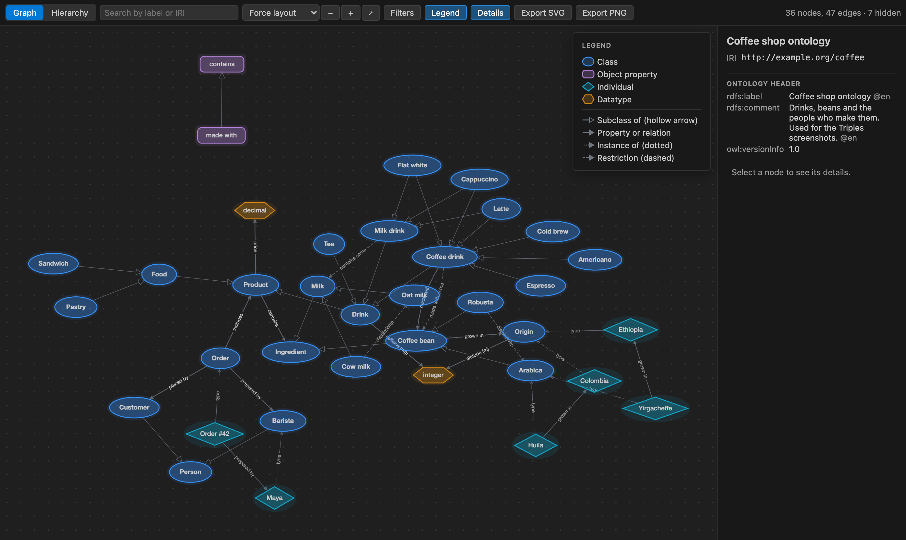
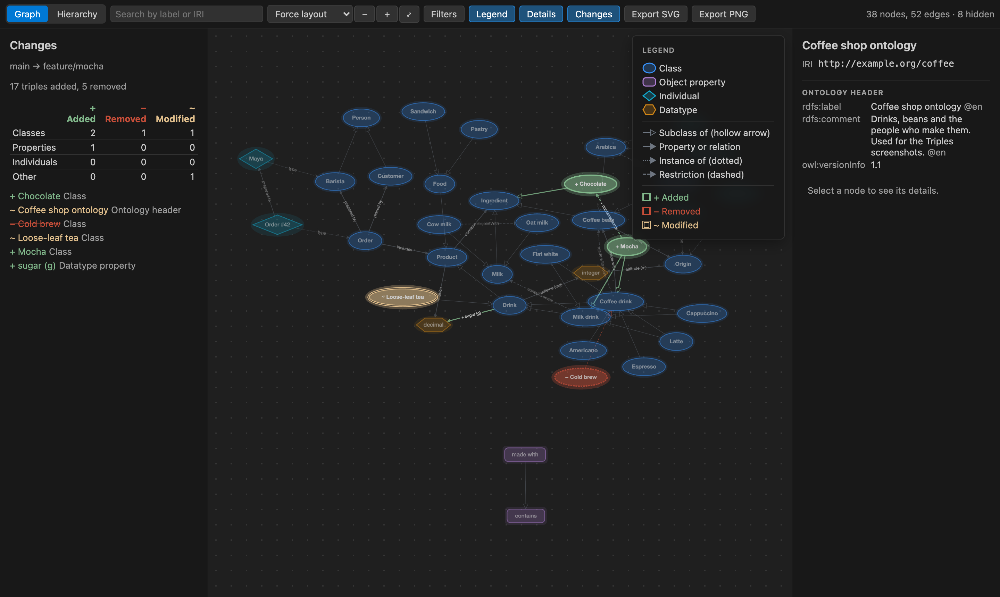
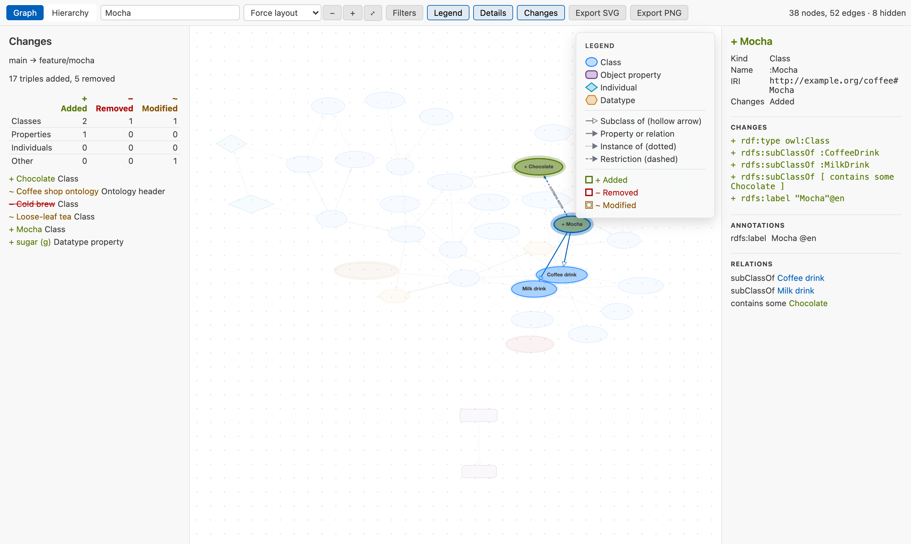
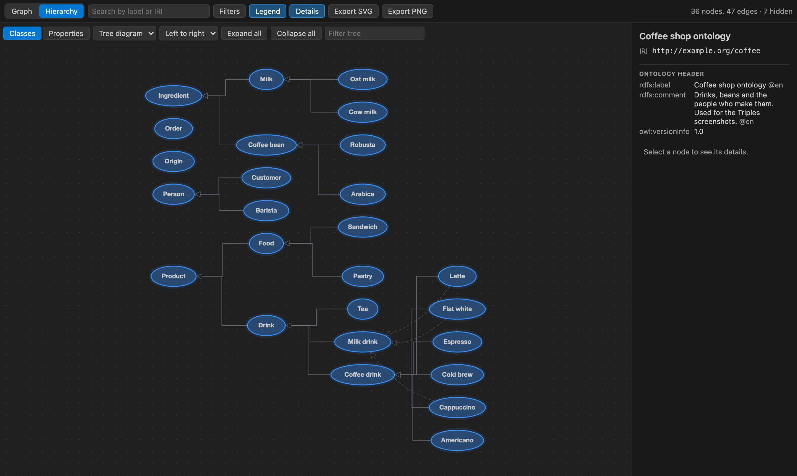
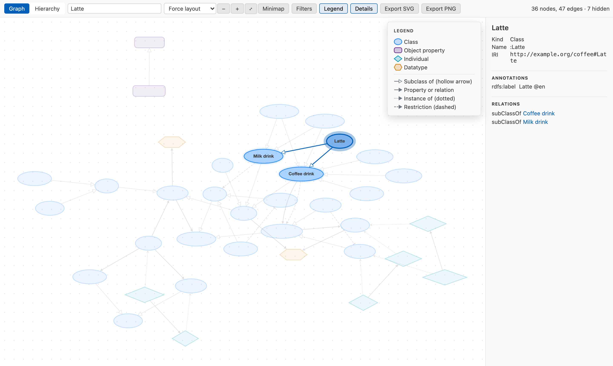

# Triples

**See your ontology.** Triples turns Turtle, OWL and other RDF files into a clear, interactive graph inside VS Code, and shows what changed between two versions.



## Screenshots

**Semantic diff.** Compare a branch with `main`: added classes are green, removed are red and dashed, modified are amber. The summary panel counts changes and links to each one.



**Focus on a node.** Select a node to highlight its neighbors and read its IRI, annotations, changes and relations in the details panel.



**Hierarchy as a tree diagram.** Classes laid out by `rdfs:subClassOf`, left to right. Classes sit under their first parent; links to other parents are dashed, so the tree stays readable.



**Light theme.** Colors follow your VS Code theme, including high contrast.



The example files are in [examples/](examples/).

## Features

- **Graph view**: classes, properties and individuals as nodes with labeled arrows. Zoom, pan, fit to screen, force or layered layout, and an optional minimap that shows the whole graph and moves the view when clicked or dragged.
- **Hierarchy view**: class and property trees by `rdfs:subClassOf` and `rdfs:subPropertyOf`, as an outline or a tree diagram. Multiple parents are marked. Selection stays in sync with the graph view.
- **Readable by default**: labels from `rdfs:label` in your VS Code language, collapsed prefixes (`foaf:Person`), the compact name next to labels that several nodes share (`Person (foaf:Person)`), distinct shapes and colors per kind, and a legend. Blank nodes are named after the values they hold, such as `dateTime gteq launchDate`, instead of "anonymous". `owl:Thing`, annotation links and data values are hidden until you turn them on.
- **SHACL shapes**: node shapes are drawn as shapes, and their target classes as classes. A simple property shape becomes one arrow from the shape to its class or datatype, labeled with its path and counts, such as `name [1..1]`. A property shape with more constraints stays a node named after its path, with the constraints in the details panel.
- **Details panel**: full IRI, annotations, data values and relations of the selected node.
- **Search and focus**: find any node by label or IRI. Double-click a node to focus on its neighborhood.
- **Filters**: by node kind, namespace and relation type.
- **Semantic diff**: compare two versions of an ontology. Added nodes are green, removed are red and dashed, modified are amber. Reordering, whitespace, prefix changes and syntax changes (Turtle to RDF/XML) are ignored, because Triples compares the data, not the text. Unchanged OWL restrictions stay unchanged, even when their blank nodes get new labels.
- **Keyboard**: in the graph, arrow keys move to the connected node in that direction, Enter selects the node in the middle or focuses on the selected one, Escape clears the selection, `+`, `-` and `0` zoom and fit. With nothing selected, arrow keys pan. Screen readers announce the selected node's label, kind and change status.
- **Export**: the current view as SVG or PNG.
- **Live**: the view refreshes while you edit, and keeps zoom, pan and selection, also after a window reload.
- **Large files**: above 20,000 nodes the graph waits for you. Search for a node to see its neighborhood, filter, open the hierarchy, or draw everything anyway.
- **Clear errors**: parse errors show the line and a "Go to line" link.
- **Private and offline**: no network access, no telemetry. JSON-LD remote contexts are refused, not fetched.

## Supported formats

| Format                   | Extensions            |
| ------------------------ | --------------------- |
| Turtle, N3               | `.ttl`, `.n3`         |
| RDF/XML (OWL)            | `.owl`, `.rdf`        |
| JSON-LD                  | `.jsonld`             |
| N-Triples, N-Quads, TriG | `.nt`, `.nq`, `.trig` |
| OWL Functional Syntax    | `.ofn`                |
| OWL/XML                  | `.owx`                |
| Manchester Syntax        | `.omn`                |

`.owl` files in Turtle, Functional Syntax, OWL/XML or Manchester Syntax are detected and work too.

## Usage

1. Open an ontology file.
2. Click the Triples button in the editor title bar, or right-click the file in the Explorer, or run **Open with Triples by Radost IT** from the Command Palette. The visualizer opens beside the text.
3. Use the toolbar to switch between **Graph** and **Hierarchy**, search, filter, change the layout and export. Triples remembers the view per file.

You can also right-click a file and choose **Open With... > Triples Visualizer**.

### Comparing versions

- **Triples: Compare Ontology with HEAD** shows the uncommitted changes of the current file.
- **Triples: Compare Ontology with Branch, Tag or Commit...** lets you pick any Git revision.
- **Triples: Compare Two Ontologies** compares two files. Select two files in the Explorer, or pick them in a dialog.
- **Triples: View Ontology Changes** is in the Source Control view on a changed file, and in the title bar of any diff editor. In the Source Control view it matches Git: under **Changes** it compares the staged file with the working copy, and under **Staged Changes** (**View Staged Ontology Changes**) it compares HEAD with the staged file. This includes pull request diffs from the GitHub Pull Requests extension, so you can review the PR base against the head. In that extension's file tree, right-click a changed ontology and choose **View Ontology Changes**.

The changes panel lists added, removed and modified classes, properties and individuals, each with its added and removed statements underneath. Click a name to jump to the node, or the arrow to fold its statements. In the filters, **Show only changes** hides everything else except a ring of unchanged neighbors in the graph, and the path to each changed class or property in the hierarchy.

A new or deleted file shows everything as added or removed. A renamed IRI shows as removed plus added.

## Development

Requires Node.js 22 or newer.

```
npm install
npm run build        # bundle extension and webview into dist/
npm run watch        # rebuild on change
npm run lint         # ESLint and type check
npm run format:check # Prettier
npm test             # unit tests (Vitest)
npm run test:vscode  # integration tests in a downloaded VS Code
```

Press **F5** in VS Code to start the Extension Development Host.

GitHub Actions runs lint, the format check, unit tests, integration tests and packaging on Linux, Windows and macOS for every push to `main` and every pull request. The Linux job uploads the `.vsix` as a build artifact.

To refresh the README screenshots, build first, then run the script. It opens the webview in headless Chrome with VS Code theme colors and renders the files in `examples/` to `docs/images/`. Set `CHROME` if Chrome is not in the default location.

```
npm run build
npm run screenshots
```

To add a language, create `l10n/bundle.l10n.<locale>.json` (for example `bundle.l10n.de.json`) that maps each English message in `src/extension/strings.ts` and `src/webview/strings.ts` to its translation, keeping placeholders such as `{0}`. Command titles go in `package.nls.<locale>.json`. Messages without a translation stay in English.

Source layout:

- `src/core`: parsing, model, diff and view logic. No VS Code or DOM APIs.
- `src/extension`: commands, panels, custom editor and Git integration.
- `src/webview`: the UI, plus the Web Worker that parses files.
- `test/fixtures`: sample ontologies and before/after pairs for diff tests.

Design notes are in [docs/decisions.md](docs/decisions.md) and dependency licenses in [docs/dependencies.md](docs/dependencies.md).

## Packaging

```
npm install
npm run package
```

This runs a production build and writes `triples-<version>.vsix`. Install it with:

```
code --install-extension triples-<version>.vsix
```

Run `npx vsce ls` to see which files go into the package.

## Deploy

Publishing needs accounts that only a maintainer can create:

1. **VS Code Marketplace**: create the publisher `RadostIT` at https://marketplace.visualstudio.com/manage and a Personal Access Token in Azure DevOps with the scope "Marketplace (Manage)". Then run `npx vsce login RadostIT` and `npx vsce publish`.
2. **Open VSX**:
   1. Sign in at https://open-vsx.org with GitHub.
   2. In your profile settings, link an Eclipse Foundation account and sign the Publisher Agreement. Publishing fails without it.
   3. Create a token at https://open-vsx.org/user-settings/tokens ("Generate New Token"). It is shown only once, so store it safely.
   4. Install the CLI and claim the namespace once:

      ```sh
      npm install -g ovsx
      ovsx create-namespace RadostIT -p <token>
      ```

   5. Build the package with `npm run package`, then publish it:

      ```sh
      ovsx publish triples-<version>.vsix -p <token>
      ```

After the first manual release, the `Release` workflow publishes to both stores:

1. In the GitHub repository, open Settings > Secrets and variables > Actions and add `VSCE_PAT` (the Azure DevOps token) and `OVSX_PAT` (the Open VSX token).
2. Bump `version` in `package.json` and add a `CHANGELOG.md` entry. Commit and push to `main`.

When CI passes on `main` and the `package.json` version has no tag yet, CI creates the `v<version>` tag and starts the `Release` workflow. Pushing a `v<version>` tag by hand also starts it.

The workflow checks that the tag matches `package.json`, runs lint and all tests, publishes the `.vsix` to both stores and attaches it to a GitHub release.

## License

[MIT](LICENSE)

## About

Built by [Radost IT](https://radostit.com).
